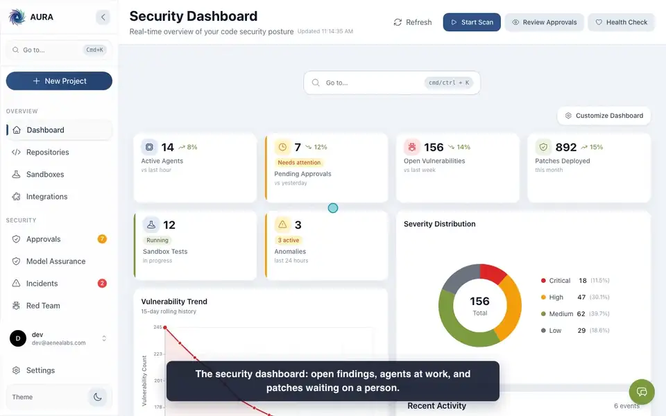
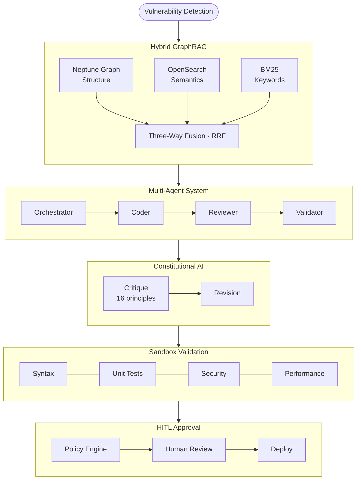

# Project Aura

**Autonomous AI security platform for enterprise codebases.**

[](LICENSE)
[](https://python.org)
[](tests/)
[](docs/PROJECT_STATUS.md)

Project Aura is building end-to-end security remediation for regulated industries: detect vulnerabilities, generate patches with a multi-agent AI system, validate them in isolated sandboxes, and queue them for human approval.

> **Current status (October 2026).** The agent loop runs today: Coder, Reviewer and Validator agents call Claude on AWS Bedrock, repair failed patches, and create a human-approval request. Several stages are not yet connected end to end: jobs start from a free-text prompt against a configured project rather than from scanner findings, the sandbox step is skipped unless a sandbox is configured and does not yet receive the patch, and approval records a decision without opening a pull request. Many capabilities described below are built and tested as libraries but not yet invoked by the running service. [`docs/PROJECT_STATUS.md`](docs/PROJECT_STATUS.md) records the verified status of each capability.

[Documentation](docs/product/getting-started/index.md) | [Quick Start](#quick-start) | [Architecture](#architecture) | [Contributing](CONTRIBUTING.md)

---

## Why Aura?

Traditional security tools identify problems. Aura solves them.

```
Traditional Scanner                          Aura
-------------------                          ----
SQL Injection found in user_service.py:47    SQL Injection found in user_service.py:47
Severity: Critical                           Severity: Critical
Recommendation: Sanitize user input          Patch generated: parameterized query via ORM
                                             Sandbox validation: PASSED (all tests green)
Then what?                                   Awaiting human approval for deployment...
  - Engineer researches the fix
  - Engineer writes the patch
  - Engineer tests the patch
  - Engineer deploys the fix
  - 45 days later...
```

**Key differentiators:**

- **Remediation, not just detection** -- generates context-aware patches using codebase context (the detection-to-patch hand-off is in progress)
- **Hybrid GraphRAG architecture** -- combines structural analysis (call graphs, dependencies) with semantic search for comprehensive code context
- **Multi-agent collaboration** -- specialized Coder, Reviewer, and Validator agents with checks and balances
- **Human-in-the-loop governance** -- configurable approval workflows with industry-specific policy presets
- **Sandbox validation** -- container-isolated ECS Fargate test environments (infrastructure built; passing the patch into the sandbox is in progress)
- **Constitutional AI guardrails** -- 16-principle critique-revision pipeline (built and evaluated nightly; inline agent integration pending)
- **Aerospace / safety-critical verification** -- Deterministic Verification Envelope (ADR-085): DO-178C-aligned output verification via N-of-M consensus, MC/DC structural coverage, and Z3 formal verification with DAL-A/DAL-B policy profiles (implemented as a library; not yet integrated into the pipeline)
- **Continuous model assurance** -- provenance verification, frozen reference oracle, anti-Goodhart controls, shadow deployment, and rollback for model swaps (ADR-088; implemented as a library, not yet integrated)

## Platform View

A look inside the Aura Platform.

<p align="center">
  <a href="assets/media/aura-demo.mp4"></a>
</p>

<p align="center"><em>Highlights (45 seconds).</em> <a href="assets/media/aura-demo.mp4"><strong>Watch the full clip</strong></a> (93 seconds, captioned)</p>

<p align="center">
  
</p>

<p align="center">
  
</p>

<p align="center">
  
</p>

<p align="center">
  
</p>

<p align="center">
  
</p>

<p align="center">
  
</p>

<p align="center">
  
</p>

<p align="center">
  
</p>

<p align="center">
  
</p>

<p align="center">
  
</p>

<p align="center">
  
</p>

The screenshots and clip are generated from the running frontend in dev mode with no backend, so the data shown is sample data. They are produced by the
scripts in [`scripts/readme_media/`](scripts/readme_media/): `capture_screenshots.py`,
`record_demo.py`, then `make_highlights.py` (and `make_social_clip.py` for a square social clip).

---

## Architecture

Aura's security remediation pipeline is a layered architecture in which specialized AI agents collaborate through structured workflows — from vulnerability detection through GraphRAG context retrieval, patch generation, sandbox verification, and HITL approval.



### Core Components

| Component | Purpose | Technology |
|-----------|---------|------------|
| **Agent Orchestrator** | Coordinates remediation workflows; the job server runs the HITL workflow (code, review, validation, a sandbox step that reports SKIPPED unless `SANDBOX_ENABLED=true`, then an approval request) | Python, FastAPI |
| **Hybrid GraphRAG** | Code context via graph + vector retrieval | Neptune (Gremlin), OpenSearch (k-NN) |
| **Multi-Agent System** | Specialized agents for code gen, review, validation | LLMs via AWS Bedrock |
| **Constitutional AI** | Principled safety guardrails for agent outputs (library; not yet applied inline) | Critique-revision pipeline |
| **Sandbox Network** | Isolated environments for patch validation | ECS Fargate, container-level network isolation |
| **HITL Workflows** | Human approval gates (every patch requires approval today) | 4 autonomy levels, 7 policy presets (policy service built; not yet applied to the pipeline) |

### Technology Stack

| Layer | Technologies |
|-------|-------------|
| **Backend** | Python 3.11+, FastAPI |
| **LLM Integration** | AWS Bedrock, Anthropic Claude in three tiers (Haiku / Sonnet / Opus families); models resolved per deployment, see [Model Selection](#model-selection) |
| **Graph Database** | AWS Neptune (Gremlin query language) |
| **Vector Search** | AWS OpenSearch with k-NN |
| **Container Orchestration** | AWS EKS with EC2 Managed Node Groups |
| **Infrastructure as Code** | AWS CloudFormation (181 templates, excluding 13 archived) |
| **Frontend** | React 19, JavaScript (JSX), Vite, Tailwind CSS v4 |
| **Service Discovery** | dnsmasq (3-tier architecture with DNSSEC) |

---

## Key Capabilities

### Hybrid GraphRAG

Aura's retrieval architecture is designed around three methods:

- **Graph traversal** (Neptune) -- call graphs, dependency chains, inheritance hierarchies
- **Semantic search** (OpenSearch k-NN) -- embedding-based similarity for related patterns
- **Keyword search** (BM25) -- exact identifier and function name matching

The three-way design fuses results with Reciprocal Rank Fusion (RRF); published research reports a 22-25% MRR improvement over single-method retrieval, which has not been measured on Aura. The RRF service is implemented but not yet wired in: the agent workflow currently combines one graph traversal with one k-NN vector search. Graph entities are extracted for Python and JavaScript/TypeScript; other languages are indexed for vector search only.

### Multi-Agent System

Specialized agents collaborate through structured message passing:

| Agent | Responsibility |
|-------|----------------|
| **Orchestrator** | Coordinates workflow phases, manages state and checkpoints |
| **Coder** | Generates patches as a tool-use agent with read-only project tools (`search_code`, `read_file`, `list_directory`), then submits code through a `submit_code` tool |
| **Reviewer** | Validates patches against OWASP Top 10 and security policies; reports its verdict through a `report_security_review` tool |
| **Validator** | Executes 5-layer validation pipeline in sandboxed environments |
| **Monitor** | Records per-run token estimates, generated lines and security findings (health tracking, alerting and CloudWatch publishing are planned) |

Neural memory guidance from past remediations (ADR-029 Phase 2.1) is included in both the Coder and Reviewer prompts. A patch must pass both the security review and validation; when either fails, the findings (validation issues include line numbers) go back to the Coder for another attempt, up to `max_remediation_attempts` (default 3). In the HITL workflow, a patch that fails its sandbox tests gets up to `max_sandbox_repairs` (default 1) repair runs in which the Coder sees the failing tests and errors. Code the Coder submits always goes through review, validation, the sandbox step (runtime tests are skipped unless a sandbox is configured, and do not yet receive the patched code), and human approval; its tools cannot write to the project. Approval records the decision; opening a pull request after approval is planned.

### Configurable Autonomy

The autonomy policy service (ADR-032) defines HITL requirements per organization. Applying these policies to the remediation pipeline is planned; today every patch requires human approval.

| Autonomy Level | Behavior | Use Case |
|----------------|----------|----------|
| `FULL_HITL` | All changes require approval | Maximum oversight |
| `CRITICAL_HITL` | Approve critical/high severity only | Balanced automation |
| `AUDIT_ONLY` | No approval; all actions logged | Low-risk changes with an audit trail |
| `FULL_AUTONOMOUS` | No approval required | Development environments |

**7 industry presets:** `defense_contractor`, `financial_services`, `healthcare`, `fintech_startup`, `enterprise_standard`, `internal_tools`, `fully_autonomous`

**Guardrails that always require humans (defined in the policy service):** production deployments and credential modifications cannot be bypassed by any preset (`IMMUTABLE_GUARDRAILS`); access control changes, database migrations and infrastructure changes are guarded by default.

### Constitutional AI

Aura includes a critique-revision pipeline based on [Anthropic's Constitutional AI research](https://arxiv.org/abs/2212.08073). It is built and tested (463 tests) and runs in the nightly evaluation Lambda; applying it inline to production agent output is planned:

- **16 principles** across Safety, Compliance, Anti-Sycophancy, Transparency, Helpfulness, and Code Quality
- **Cost-optimized design**: a fast model for critique and a more capable model for revision
- **Constructive engagement**: Issues are revised, not just blocked
- **Trust Center dashboard**: UI for critique accuracy, revision convergence, and cache hit rate (currently shows sample data unless DynamoDB-backed mode is enabled)

### AI Optimizations

Figures in this table are design targets or published research results, not measurements of Aura workloads.

| Technique | Status in Aura |
|-----------|----------------|
| Chain of Draft prompting | Used in Coder, Reviewer, Validator and planner prompts (published research reports up to 92% token reduction vs. Chain of Thought) |
| Semantic caching (OpenSearch k-NN) | Implemented and reachable from the API |
| Self-reflection (Reflexion-style) | Implemented in the Reviewer (up to 3 iterations); design target of 30% fewer false positives, not measured |
| Selective decoding (JEPA) | Prototype; untrained scaffold, not wired |
| Titan Neural Memory | Implemented as a library (PyTorch test-time learning); off by default and wired with mock stores |
| Recursive context scaling (RLM) | Prototype; not wired (design target: 100x context expansion) |

---

## Quick Start

### Prerequisites

- Python 3.11+
- AWS CLI configured with appropriate credentials
- Podman (recommended) or Docker

### Installation

```bash
git clone https://github.com/aenealabs/aura.git
cd aura
pip install -r requirements.txt
```

### Run Tests

```bash
pytest tests/
```

Local development and the test suite run the Bedrock service in MOCK mode: no AWS calls are made, and `auto` model settings resolve to the built-in current models, which are never invoked.

### Deploy to AWS

```bash
# One-command clean-account deploy (bootstrap + state machine)
ALERT_EMAIL=ops@example.com ./deploy/deploy.sh deploy dev
```

The single command runs bootstrap (23 layer CodeBuild projects + private ECR base images + deployment-pipeline state machine) and then triggers the state machine to deploy every layer in dependency order.

See the [Installation Guide](docs/product/getting-started/installation.md) for SaaS, Kubernetes, and Podman deployment options, and the [Deployment Guide](docs/deployment/DEPLOYMENT_GUIDE.md) for the canonical AWS infrastructure deploy reference.

---

## Configuration

### Model Selection

Aura uses three model tiers (ADR-015): **fast** (Haiku family), **accurate** (Sonnet family), and **maximum** (Opus family). Each tier's model is resolved in this order:

1. The environment's Secrets Manager secret, `aura/<env>/bedrock-config`
2. The environment's entry in `src/config/bedrock_config.py`
3. The default, `auto`: a deployment-wide `AURA_MODEL_<TIER>` pin if set, otherwise the model discovered on Bedrock

**`auto`** -- at service startup in AWS mode, Aura lists the Anthropic models and inference profiles in the deployment region (`ListFoundationModels`, `ListInferenceProfiles`) and picks the newest ACTIVE, priced Claude model for each tier. When a model is not available on-demand, Aura uses its inference profile ID. A fresh deployment therefore picks up current models rather than a hard-coded 2024 default.

**Pinning** -- an explicitly configured model ID always wins over discovery. Operators pin approved models in the secret with these keys:

| Key | Purpose |
|-----|---------|
| `model_id_fast`, `model_id_accurate`, `model_id_maximum` | Model per tier |
| `model_id_primary`, `model_id_fallback` | Primary and fallback model |
| `model_pricing` | Per-model `input_per_million` / `output_per_million` prices |
| `prompt_cache_models` | Models that accept prompt-cache breakpoints |

A configured model with no known pricing is refused at startup, and that tier keeps its fallback. Model upgrades follow ADR-088 ([Continuous Model Assurance](docs/architecture-decisions/ADR-088-continuous-model-assurance.md)): evaluate the candidate, review the shadow report, get human approval, then change the configuration with the previous value stored for rollback.

**Per-model request handling** -- newer models (Sonnet 5+, Opus 4.7+, Fable/Mythos) reject a non-default `temperature`, and some reject a forced `tool_choice`. Aura omits or adapts those fields for known models; for others, on a 400 error naming the field it retries without it and remembers that for the model.

**Prompt caching** -- tool-use conversations add cache breakpoints for models listed in `prompt_cache_models`. Cost tracking prices cache writes at 1.25x and cache reads at 0.1x the model's input price.

**IAM** -- the service role needs `bedrock:ListFoundationModels` and `bedrock:ListInferenceProfiles` in addition to `bedrock:InvokeModel`, and `InvokeModel` must also cover inference-profile resources.

---

## Deployment Options

| Option | Status | Best For |
|--------|--------|----------|
| **AWS (CloudFormation)** | Deployed to DEV and QA in AWS Commercial; currently spun down for cost | Aura-managed environments |
| **Self-Hosted (Kubernetes)** | Partial: Helm charts and installers in `deploy/`; not validated with a customer | Organizations with data residency requirements or existing EKS clusters |
| **Self-Hosted (Podman)** | Partial: Podman Compose file not yet in the repository | Air-gapped deployments, small teams, proof-of-concept |

Templates use partition-aware ARNs for AWS GovCloud compatibility; no GovCloud deployment exists yet.

---

## Security and Compliance

### Data Protection

| Control | Implementation |
|---------|----------------|
| Encryption at rest | AES-256 via AWS KMS (customer-managed keys on part of the estate; coverage is partial) |
| Encryption in transit | TLS (minimum TLS 1.2 on public and OpenSearch endpoints) |
| Network isolation | VPC endpoints, no public internet exposure |
| Secrets management | AWS Secrets Manager, no hardcoded credentials |
| Container security | Private ECR base images, vulnerability scanning |

### Compliance Posture

| Framework | Status |
|-----------|--------|
| NIST 800-53 | Technical controls aligned; not audited |
| SOX | Change-approval controls aligned; not audited |
| GovCloud Ready | 19/19 deployed services compatible; no GovCloud deployment yet |
| CMMC Level 2 | Not yet pursued |
| FedRAMP High | Not yet pursued (roadmap) |

### Security Services

Running on the request path today: an LLM prompt sanitizer and Bedrock Guardrails on every model call, A2AS screening at orchestrator entry, and semantic-guardrail Layers 1-2 on ingested repository content.

Built and tested as libraries, not yet wired onto API routes:

- Input validation (SQL injection, XSS, SSRF, prompt injection detection)
- Secrets detection (entropy-based, multiple secret types)
- Security audit logging with CloudWatch and DynamoDB persistence
- Threat intelligence with blocklist updates
- Semantic guardrails engine (full 6-layer engine; Layers 3-5 currently mock-backed)
- Agent capability governance (4-tier tool classification; enforcement not yet wired)

---

## Documentation

### Getting Started

- [Platform Overview](docs/product/getting-started/index.md) -- What is Aura, key benefits, use cases
- [Quick Start Guide](docs/product/getting-started/quick-start.md) -- Get running in 5 minutes
- [System Requirements](docs/product/getting-started/system-requirements.md) -- Prerequisites
- [Installation Guide](docs/product/getting-started/installation.md) -- SaaS, Kubernetes, Podman deployment
- [First Project Walkthrough](docs/product/getting-started/first-project.md) -- Connect a repository and run your first scan

### Core Concepts

- [Autonomous Security Intelligence](docs/product/core-concepts/autonomous-security-intelligence.md) -- LLM-powered remediation
- [Hybrid GraphRAG](docs/product/core-concepts/hybrid-graphrag.md) -- Neptune + OpenSearch architecture
- [Multi-Agent System](docs/product/core-concepts/multi-agent-system.md) -- Agent orchestration
- [HITL Workflows](docs/product/core-concepts/hitl-workflows.md) -- Autonomy levels and policy presets
- [Sandbox Security](docs/product/core-concepts/sandbox-security.md) -- Isolated validation model

### Operations and Support

- [System Architecture](docs/SYSTEM_ARCHITECTURE.md) -- Technical design and deployment topology
- [API Reference](docs/support/api-reference/index.md) -- REST API (GraphQL and outbound webhooks planned)
- [Troubleshooting](docs/support/troubleshooting/index.md) -- Common issues and solutions
- [Monitoring and Operations](docs/support/operations/index.md) -- Observability, logging, scaling
- [FAQ](docs/support/faq.md) -- Frequently asked questions

### Architecture Decisions

The project maintains [Architecture Decision Records](docs/architecture-decisions/) documenting rationale for significant design choices. Key ADRs include:

- **ADR-024**: Titan Neural Memory Architecture
- **ADR-034**: Context Engineering Framework
- **ADR-063**: Constitutional AI Integration
- **ADR-065**: Semantic Guardrails Engine
- **ADR-083**: Runtime Agent Security Platform
- **ADR-085**: Deterministic Verification Envelope (DO-178C, N-of-M consensus, MC/DC, Z3 formal verification)
- **ADR-087**: Hyperscale Agent Orchestration
- **ADR-088**: Continuous Model Assurance (provenance, frozen oracle, anti-Goodhart, rollback)
- **ADR-091**: Cognito Cross-Region Disaster Recovery (Lambda-based mirror to DDB Global Table, standby pool, force re-auth on failover)

---

## Project Stats

| Metric | Value |
|--------|-------|
| Lines of Code | 411,771 (`src/` + `deploy/`; tests counted separately at 315,845). Reproduce: `cloc src/ deploy/ --md` |
| Test Suite | 27,161 tests collected on 2026-10-26. Reproduce: `pytest --collect-only -q tests/` |
| Architecture Decision Records | 95 ADRs (plus 1 reserved number) |
| CloudFormation Templates | 181 templates (excluding 13 archived) |
| Infrastructure Phases | 9 of 9 layers templated and deployed to DEV (environments currently spun down) |

---

## Security Architecture

Aura's design addresses known agentic AI attack vectors including command injection, prompt injection, dependency confusion, and agent execution escape. Key architectural controls (status as of October 2026):

- **Command Execution:** Allowlist-based filtering with `shell=False` enforcement via `SecureCommandExecutor` — eliminates shell metacharacter and Unicode bypass attacks
- **Prompt Injection Defense:** LLM prompt sanitizer and Bedrock Guardrails on every model call, A2AS screening at orchestrator entry, and semantic-guardrail Layers 1-2 (Unicode normalization, pattern matching) on ingested repository content; the full 6-layer engine (adding embedding similarity, LLM-as-judge, session tracking and a decision engine) is built but not yet on the request path
- **Supply Chain:** Private ECR base images; dependency confusion detector (typosquatting, namespace hijacking, version confusion) and SBOM attestation with Sigstore signing are built as libraries, not yet wired
- **Agent Isolation:** Container-level ECS Fargate sandboxing (no inbound rules, no public IP, egress limited to DNS and HTTPS); 4-tier tool classification with default-deny policy and eBPF escape detection are built as libraries, not yet wired
- **Agent Governance:** Human approval required for every patch today; configurable autonomy levels, time-bounded dynamic grants, and shadow agent detection with behavioral baselines and quarantine are built as libraries, not yet wired

For details, see [Security Architecture](docs/support/architecture/security-architecture.md).

---

## Contributing

We welcome contributions. See [CONTRIBUTING.md](CONTRIBUTING.md) for:

- Issue management and labels
- Pull request process and review standards
- Commit message format (Conventional Commits)
- Branch naming conventions
- Release process

---

## Reporting Security Vulnerabilities

If you discover a security vulnerability, please report it responsibly. Do **not** open a public GitHub issue for security vulnerabilities.

Email: **security@aenealabs.com**

We will acknowledge receipt within 48 hours and provide a detailed response within 5 business days.

---

## License

Project Aura is licensed under the [Business Source License 1.1](LICENSE).

The BSL allows you to use the source code for non-production purposes. Production use requires a commercial license from Aenea Labs. The license converts to open source (Apache 2.0) after the change date specified in the LICENSE file.

---

## About

Project Aura is designed for security teams that need to remediate vulnerabilities at scale while maintaining compliance audit trails. The platform is purpose-built for regulated industries — defense, financial services, healthcare, and government contracting — where AI-generated code, AI agents, and software supply chains all require continuous security oversight.
